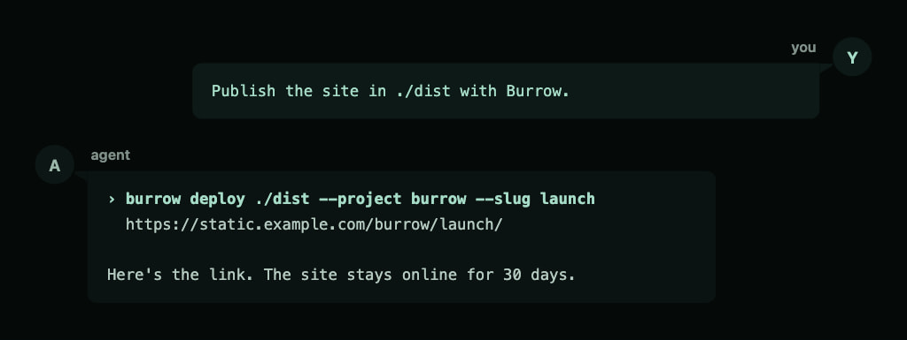
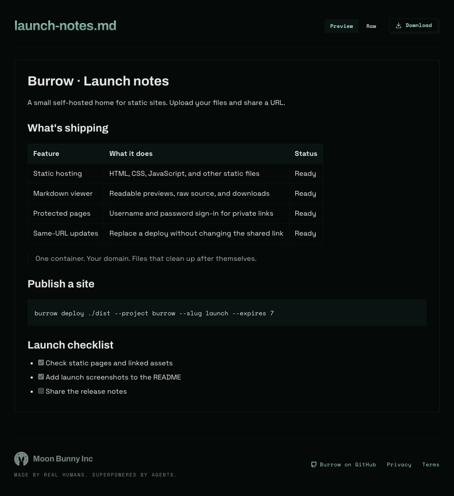
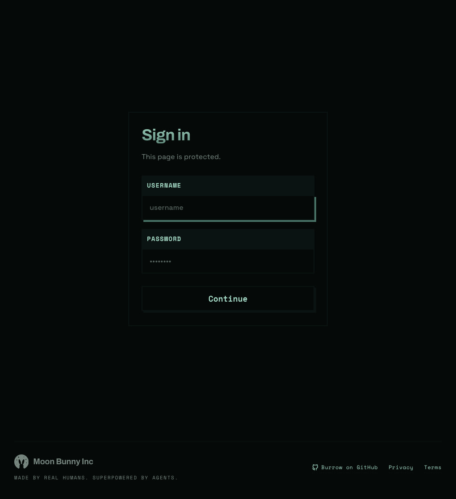
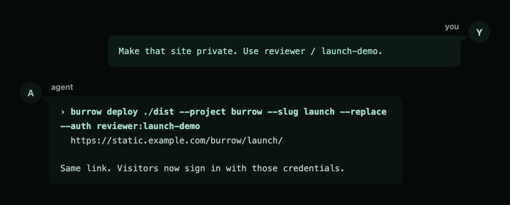
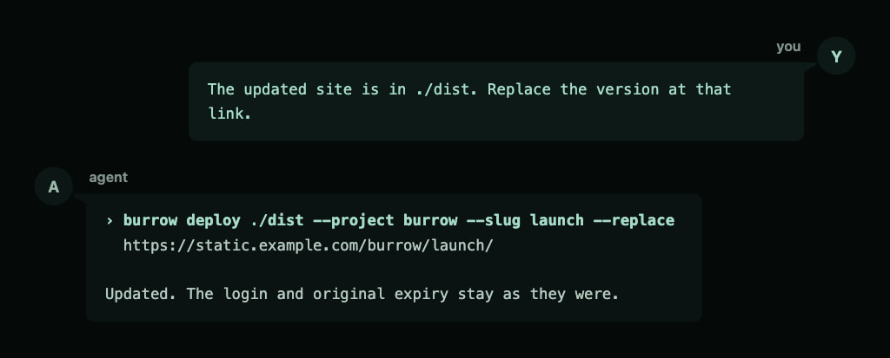
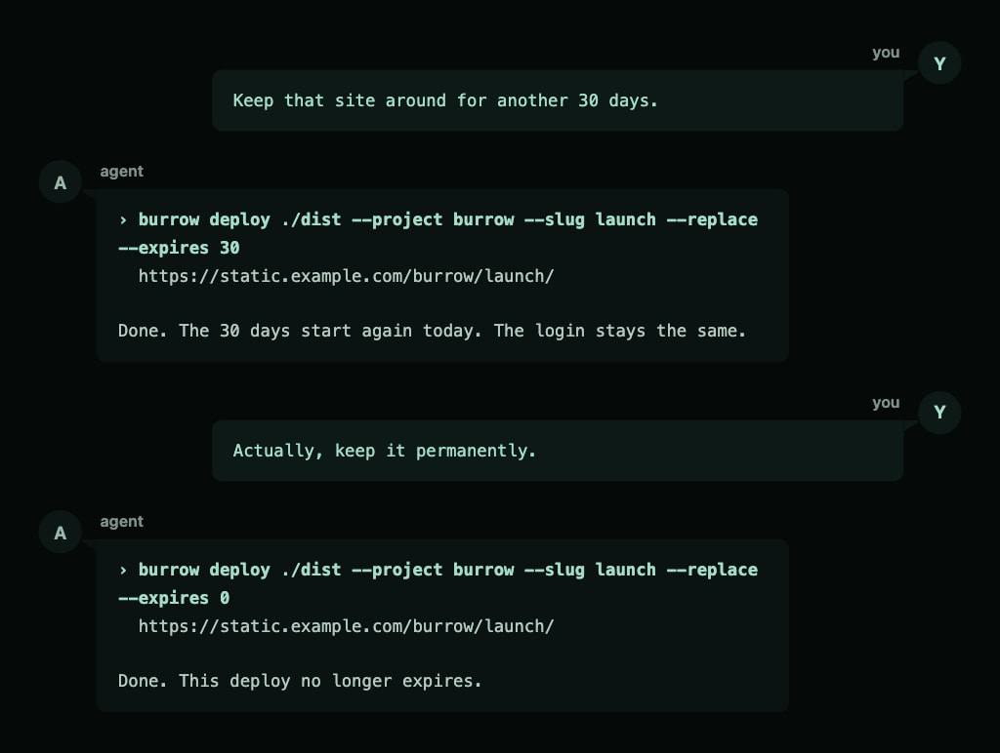

<h1 align="center">Burrow</h1>
<p align="center">A temporary home for static sites.</p>

<p align="center">
  
</p>

I wanted a simple way to share the sites my agents build. Something I could put online without giving every throwaway project a permanent home.

Burrow is a small static host you run on your own server. Its CLI uploads a site or any other static files and gives you a URL. Deploys expire after 30 days by default. You choose how long they stay.

### Deploy with Burrow

Run the CLI yourself or ask your agent to publish a site:



Burrow also gives Markdown a readable preview and can put a sign-in page in front of any deploy.

| Markdown preview | Password protection |
| :-: | :-: |
|  |  |

### Add a password

If the site isn't public yet, put a login in front of it. Your agent updates the existing link with a username and password.



### Update the site, keep the link

Build the updated site, then ask your agent to replace the deployed version. Everyone keeps using the same URL.



Replacement swaps all files in that deploy. The login and exact expiration date stay unchanged unless you supply new settings.

### Choose how long it stays

New deploys last 30 days by default. If you still need the site, ask for a fresh countdown. Or keep it permanently.



## CLI

Needs Node.js 22 or later and `tar`. Run the CLI through an exact npm version:

```sh
npx --yes @mnbny/burrow@0.1.0 readme
```

Working with an agent? Give it this prompt:

```text
Run npx --yes @mnbny/burrow@0.1.0 readme and help me set up Burrow.
```

Once your [server](#server) is running, configure its URL and a deploy token:

```sh
export BURROW_HOST=https://static.example.com
export BURROW_TOKEN=your-deploy-token
npx --yes @mnbny/burrow@0.1.0 deploy ./dist --project burrow --slug launch
```

The examples below use `burrow` as shorthand for `npx --yes @mnbny/burrow@0.1.0`.

To run from a checkout, link the bundled CLI and put `~/.local/bin` on your `PATH`:

```sh
git clone git@github.com:mnbny/burrow.git
cd burrow
node cli/setup.mjs
```

### burrow deploy

Ships a directory or a single file to the server, then prints the URL and nothing else, so a script can capture it. If the slug is taken, the server picks a new one unless you pass `--replace`. Trust the printed URL over the slug you asked for.

Everything serves from one domain as `/{project}/{slug}/`.

| Flag | Required | Description |
| --- | :-: | --- |
| `--project` | ✔ | First URL path segment. |
| `--slug` |  | Second URL path segment. Default: a random UUID. |
| `--replace` |  | Replace all files at `--slug`, or create it if absent. Requires `--slug`. |
| `--auth` |  | Complete `user:pass` pair required to view this deploy, via a sign-in page. Preserved on replacement when omitted. |
| `--expires` |  | Days from this deploy until deletion. `0` keeps it forever. Default: 30 for a new deploy; the existing expiration date stays unchanged on replacement when omitted. |
| `--host` | ✔\* | Server URL. |
| `--token` | ✔\* | A deploy token. |

\* The `BURROW_HOST` and `BURROW_TOKEN` env vars satisfy these; a flag wins when both are set.

The server slugifies names: `"My Report"` becomes `my-report`. A deployed `index.html` serves at the slug root; any other single file serves at its own name.

A protected deploy shows a sign-in page. A correct sign-in sets a cookie for that deploy only, good for 30 days on that device. A server restart or a change to that deploy's credentials signs viewers out.

```sh
# password-protected, gone in 7 days
burrow deploy ./coverage --project ci --slug pr-123 --auth me:secret --expires 7

# a single file, kept forever
burrow deploy report.html --project docs --expires 0
```

To update a deploy at the same URL, use an explicit slug and `--replace`:

```sh
burrow deploy ./dist --project burrow --slug launch --replace
```

The same command creates the deploy if it does not exist. Replacement removes all old files, including files absent from the new upload. For a single file, keep its filename unchanged to preserve the full URL. A failed upload leaves the existing deploy intact. There is no version history or rollback.

When you omit `--expires`, replacement preserves the existing expiration date; permanent deploys stay permanent. A 30-day deploy replaced after 15 days still has 15 days left. Supply `--expires 30` to start a new 30-day countdown from replacement.

When you omit `--auth`, replacement preserves the existing credentials. To change credentials, supply the complete `user:pass` pair. Partial or empty credentials are rejected. Content updates retain existing viewer sessions unless the credentials change.

### burrow readme

Prints this guide. Working with an agent? Tell it to run `burrow readme` and it has everything it needs.

## Markdown

Open a deployed `.md` or `.markdown` file in a browser to read it in the built-in viewer. Preview is the default. The **Preview / Raw** toggle updates the URL, so shared links, refreshes, and browser history preserve the selected mode. A separate **Download** button in both modes saves the original file.

| URL suffix               | Result                                             |
| ------------------------ | -------------------------------------------------- |
| None, or `?view=preview` | Formatted preview in a browser.                    |
| `?view=raw`              | Original source inside the viewer.                 |
| `?raw=1`                 | Original source as plain text, without the viewer. |
| `?download=1`            | Download the original file.                        |

Scripts that do not request `text/html` receive the original Markdown. The viewer supports tables, task lists, fenced code blocks, and links to document sections. Relative links and images resolve from the document URL; deploy their assets in the same directory structure. Viewing credentials protect all modes and downloads.

Markdown previews sanitize embedded HTML and leave the uploaded file unchanged.

## Server

One container. Run it behind your reverse proxy, which owns the domain and TLS. Allow request bodies at least as large as the upload cap in the proxy.

This server requires Burrow CLI 0.1.0 or newer. If a deploy reports an incompatible version, update the CLI to the minimum version stated in the error.

```sh
docker compose up -d
```

The container fixes the data path's ownership at start and then drops to an unprivileged user (uid 1000).

The compose file pulls the published image and reads these from the environment or a `.env` file beside it:

| Var | Description |
| --- | --- |
| `IMAGE_URL` | Image to run. Default: the published image. |
| `IMAGE_VERSION` | Image tag. Pin a release version or `<commit>` tag to roll back. Default: `latest`. |
| `DEPLOY_TOKENS` | Comma-separated tokens that may deploy. |
| `MAX_BODY_MB` | Upload cap in MB; extracted content caps at 10x. Default `50`. |
| `HIDE_FOOTER` | Set to `1` to remove the Moon Bunny footer from the Markdown viewer and sign-in page. Shown by default. |
| `DATA_PATH` | Host path for the deployed content. Default `./data`. |
| `PORT` | Published HTTP port. Default `8080`. |

## Development

- Node.js 22 or later and pnpm 11.
- `pnpm install`, then `node cli/setup.mjs --dev` to run your working copy as `burrow`.
- `pnpm validate` formats, lints, typechecks, and rebuilds the committed `*.bundle.mjs` files. They are generated; never edit them.
- The server source imports browser assets that require this build. Run the generated server bundle, not `server/server.mjs` directly.
- `pnpm test` runs the end-to-end harness: the real container behind a real proxy in Docker, deployed to with the real CLI, plus compatibility, npm package, and browser checks. The first run downloads Playwright's Chromium browser.
- `pnpm pack:check` checks the npm package and verifies that its CLI runs outside the checkout.
- `pnpm release` builds the server image for x86_64 and pushes `:latest` plus an immutable `:<commit>` tag. A commit tagged `v<package-version>` also publishes the matching `:<package-version>` image tag. It refuses a dirty tree.
- Use the repository's Woof `npm.version`, `npm.release`, and `docker.release` tokens for version bumps and releases. npm publication and server image publication are separate actions.
